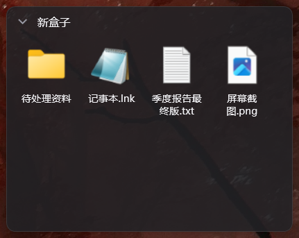
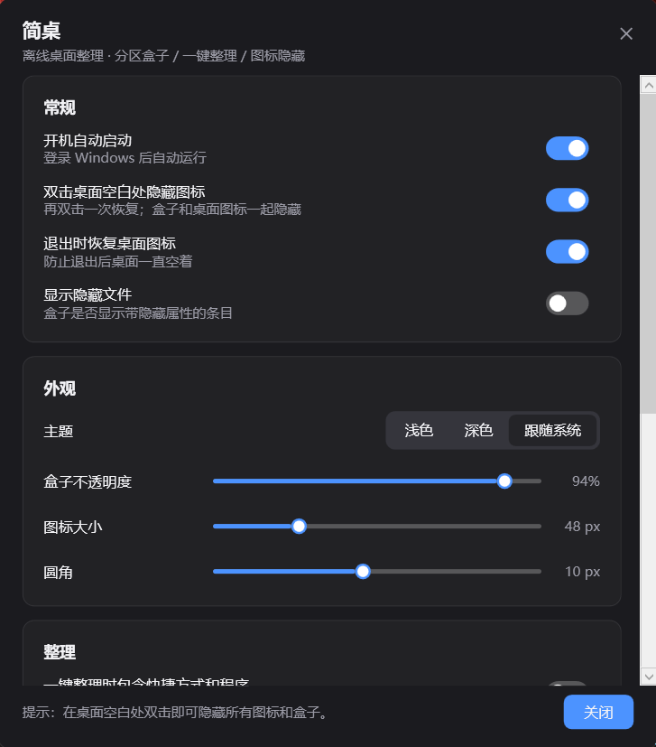

# DeskBox

一个**完全离线**的 Windows 桌面整理工具（中文名「简桌」）：分区盒子、一键整理、拖拽排序、图标隐藏。
简洁风格，无账号、无同步、无壁纸、无遥测、无广告。

> 本项目是**净室实现**：只参考了公开的功能行为描述，没有使用任何反编译代码，不包含第三方专有代码。





## 功能

| 功能 | 说明 |
| --- | --- |
| 分区盒子 | 桌面上的悬浮面板，把文件按用途分组；可新建 / 重命名 / 移动 / 缩放 / 收起 / 锁定；支持图标与列表两种视图；内容超出时用滚轮滚动，不显示右侧滚动条；快捷方式不显示 `.lnk` 扩展名 |
| 条拖动 | 盒子里的条目可以按住拖动：在同一个盒子里拖动是**调整顺序**（只改显示顺序，不动文件）；拖到别的盒子上松手就**搬到那个盒子**，并落在松手的位置 |
| 图标排布与自动高度 | 图标距盒子左右边缘固定约 11 px（逻辑像素），宽度余量均分到列间，图标少时从首列开始排，末行仍与上面的列对齐；拖左右边框调整宽度，图标视图按整列跳；高度根据当前宽度、图标数量和图标大小自动计算，增删文件时也会自动收放，超出屏幕高度时可滚动 |
| 盒子排布 | 拖动盒子时自动对齐其他盒子的边与中线（显示参考线），落位时如果压到别的盒子，自动让到最近的空位；盒子拖不出屏幕，贴边时自动留出与盒子间距相同的 12px |
| 一键整理盒子 | 把桌面上的多个盒子一键排整齐（设置窗最上面 / 托盘第一项）：按盒子现在的上下左右顺序，贴着屏幕顶部**水平居中**摆成一排，间距一致、行内顶部对齐，一行摆不下自动换行。左边特意留出空白，不会压住桌面左上角还没归盒的图标。只挪盒子的位置，盒子里的文件不动 |
| 整理桌面文件 | 把桌面上的文件按类型自动归类到「文档 / 图片 / 视频 / 音乐 / 压缩包 / 文件夹 / 其他」盒子，可一键撤销 |
| 图标隐藏 | 在桌面空白处**双击**即可隐藏全部桌面图标、盒子和任务栏（含副屏），再双击恢复；设置里可关闭任务栏联动；点任务栏、按 Win+D 都不会让盒子闪烁（见「实现要点」） |
| 系统图标入盒 | 桌面上的「控制面板 / 回收站 / 网络 / 此电脑」这类**没有文件路径的系统图标也能拖进盒子**：盒子里会生成一个指向它的快捷方式，盒子本身仍然是磁盘上的真实文件夹 |
| 桌面共存 | 按 **Win+D（显示桌面）**盒子不会消失、也不会闪；普通窗口依旧盖在盒子之上，点任务栏/切窗口不重排盒子 |
| 设置面板 | 一键整理 / 撤销整理 / 整理规则 / 主题外观 / 开机自启，都集中在这里 |
| Liquid Glass | 实时采样 Wallpaper Engine 视频壁纸，显示玻璃模糊、圆角边缘折射与鼠标高光；设置 → 外观可开关并调节背景浓度、模糊和折射；图标与文字保持清晰 |
| 任务栏玻璃 | 设置 → 外观中的「任务栏玻璃背景」独立开关：原系统任务栏使用同款玻璃背景，整条直角，共用背景浓度、模糊和折射参数；原有图标、托盘和操作保持不变，关闭或退出后恢复系统外观 |
| 程序外壳 | 托盘图标、设置面板、开机自启（任务计划程序「登录时」触发器） |

## 使用

默认外观：背景浓度 35%、图标大小 37 px、圆角 22 px、玻璃模糊 0、折射强度 28。折射只作用于边缘约 8 px 的窄带（按屏幕缩放比例调整），中间的壁纸纹理保持清晰。

可调范围：背景浓度 0–100%（0% 保留壁纸原色，100% 使用主题底色）、圆角 10–100 px、折射强度 0–80；默认圆角仍为 22 px。

任务栏玻璃默认关闭，可在设置 → 外观单独开启，与桌面盒子的 Liquid Glass 开关独立。任务栏固定为直角，不受盒子圆角滑块影响。当前支持 Windows 11 x64 和 Wallpaper Engine 视频壁纸；取不到壁纸画面时保留系统任务栏背景。桌面双击隐藏任务栏时，玻璃背景也一起隐藏。

1. 直接运行 `DeskBox.exe`。首次启动会在桌面创建 `桌面整理` 文件夹和一个示例盒子。
2. 想把盒子摆整齐，打开**设置窗口**（托盘图标双击，或再运行一次 `DeskBox.exe`），点最上面的**「一键整理盒子」**；想把桌面上的文件自动归类，就点下面的**「整理桌面文件到盒子」**。
3. 平时也可以把桌面上想归类的东西**拖进盒子里**（包括「控制面板 / 回收站 / 网络 / 此电脑」这类系统图标：它们没有文件路径，会在盒子里变成指向它的快捷方式）；整理盒内顺序时直接按住条目拖到想要的位置，跨盒子直接拖到另一个盒子上松手即可（拖动时会用一条线提示落点）。
4. 在桌面空白处双击，可以一起隐藏所有图标、盒子和任务栏专心看壁纸；再双击恢复。设置 → 常规中的「隐藏图标时同时隐藏任务栏」默认开启，关闭后只隐藏图标和盒子。退出程序总会恢复由本程序隐藏的任务栏。
5. 托盘右键 = 全部功能入口（整理盒子 / 新建盒子 / 整理桌面文件 / 撤销 / 显示隐藏图标 / 设置 / 退出）。

摆盒子时不用对齐像素：拖到另一个盒子附近会自动吸附到它的边或中线，并显示参考线；松手时如果和别的盒子压在一起，会自动让到最近的空位。盒子也不会被拖出屏幕：拖到边缘外会自动停在距屏幕边缘 12px 的地方。对齐与避让两个行为都可以在设置里关掉。

调整盒子大小时拖左右边框即可：图标视图拉宽一档正好多一列，高度自动收成刚好放下当前图标的行数。盒子高度也会随文件增删、图标大小和视图模式变化而重算，无需单独拉高或收矮。

### 关于桌面右键菜单

早期版本尝试把入口放进桌面右键菜单，现在去掉了，原因是 Windows 11 的**新版右键菜单只承载 COM 形式的 shell 扩展**：
同一个位置上的 `Open Git GUI here`、`在此处打开 Powershell 窗口`、`搜索 Everything...` 这些经典注册表项，在新菜单里同样看不到，
必须点「显示更多选项」才会出现。为了让功能开箱即用，主入口改由设置窗口承担。

旧版本写进注册表的菜单项会在启动时**自动清理**。

## 数据与安全

这是设计上最重要的一条：**盒子就是磁盘上的真实文件夹**，不含任何私有格式或数据库。

- 默认根目录：`%USERPROFILE%\Desktop\桌面整理\`
- 每个盒子 = 根目录下的一个文件夹；「解散盒子」会把里面的东西移回桌面，**不会删除文件**。
- 盒子内删除条目走的是**回收站**（`SHFileOperation` + `FOF_ALLOWUNDO`），不是永久删除。
- 「一键整理」会移动文件，但可以在设置里或右键菜单中**撤销上次整理**，会按移动日志原路搬回。
- 配置文件：**就在 exe 旁边**，例如 `dist\config.json`（原子写入，写入前自动备份一份 `config.backup.json`，损坏时自动回退）。程序放哪，配置就跟到哪。
- 日志：和配置同目录，例如 `dist\deskbox.log`
- 改名之前（「简桌 / JianZhuo」）的配置放在 `%APPDATA%\JianZhuo\`，第一次运行这个版本会自动迁移到 exe 旁边；如果 exe 所在目录不可写（例如放进 `Program Files`），会自动回退用 `%APPDATA%\DeskBox\`。
- 程序**不联网**，没有任何网络代码路径。

## 安装位置

程序是绿色单文件，不做安装。运行后涉及的位置：

| 内容 | 位置 |
| --- | --- |
| 主程序 | 你放它的地方，例如 `dist\DeskBox.exe` |
| 配置与日志 | exe 旁边的 `config.json`、`config.backup.json`、`deskbox.log`（默认；不可写时回退到 `%APPDATA%\DeskBox\`） |
| 盒子文件夹 | 默认 `%USERPROFILE%\Desktop\桌面整理\` |
| 开机自启（开启时） | 任务计划程序里的 `DeskBox` 任务（「登录时」触发，只在当前用户登录时运行；创建失败时退回 `HKCU\Software\Microsoft\Windows\CurrentVersion\Run` 的 `DeskBox` 值） |

卸载 = 删除 exe + 删除 `%APPDATA%\DeskBox` + 在设置里关掉开机自启。除此之外不写任何系统位置。
如果设置窗口已经打不开，也可以手动删掉任务计划程序里的 `DeskBox` 任务（`schtasks /delete /tn DeskBox /f`）和 HKCU Run 里的 `DeskBox` 值。

### 为什么开机自启用任务计划程序而不是 Run 键

Windows 10/11 会**故意延后** HKCU Run 里的自启动项：实测日志（事件查看器 → `Microsoft-Windows-Shell-Core/Operational`，9705/9707/9708 事件）显示，桌面切换后 14 秒才开始枚举 Run 键，DeskBox 作为第 11 项在登录后约 **37 秒**才被系统创建——用户早就进桌面了，盒子当然要等半天。

任务计划程序的「登录时」触发器由 Task Scheduler 直接触发，不经过 Explorer 的这条排队，盒子可以在进入桌面时就已经就位。开关自启时会自动注册 / 删除这个任务，旧版本写进 Run 键的值会被自动清掉并迁移到任务。注册任务不需要管理员权限；如果被组策略拦住，会自动退回 Run 键（功能仍可用，只是开机会被系统延后）。

## 下载 / 构建

**直接拿来用**：Releases 里的最新版本附带了编译好的单文件版 `DeskBox.exe`（Windows x64，自带 .NET 运行时，双击即可）。

**自己编译**：需要 .NET 8 或更高版本 SDK（Windows），以及 Visual Studio 2022 C++ Build Tools（MSVC x64 和 Windows SDK）。构建会自动编译并嵌入任务栏背景组件，发布产物仍为单文件 exe。第一次还原需要下载 Windows SDK 的 .NET 投影和 Vortice Direct3D 依赖；依赖缓存后可以离线构建。应用运行时不联网。

```powershell
git clone https://github.com/AimoStein/DeskBox.git
cd DeskBox/src/DeskBox

# 1) 普通编译 —— 产物 bin\Release\net8.0-windows10.0.22621.0\DeskBox.exe
#    体积小，但目标机器需要装 .NET 8 桌面运行时
dotnet build -c Release

# 2) 单文件绿色版 —— 产物在仓库根的 dist\，自带运行时，拷到哪都能跑
dotnet publish -c Release -r win-x64 --self-contained true `
  -p:PublishSingleFile=true -p:IncludeNativeLibrariesForSelfExtract=true `
  -p:EnableCompressionInSingleFile=true -o ..\..\dist
```

图标 `src/DeskBox/Assets/app.ico` 已经随仓库提供，**不需要额外生成**；只有想改图标样式时才跑 `pwsh -File tools/make-icon.ps1` 重新生成。

## 自检

一键整理涉及真实文件移动，所以内置了一套离线自检（在临时目录里跑，不碰真实桌面）：

```powershell
DeskBox.exe --selftest
# 结果写到 %TEMP%\deskbox-selftest.txt
```

覆盖：类型归类、快捷方式与程序不自动整理、移动落位、撤销还原、重名自动加后缀、文件名清洗、桌面图标视图定位、配置序列化往返、盒子吸附排布、图标磁盘缓存往返，以及**用 shell 自己给出的拖放数据对象**验证系统图标解析与快捷方式生成（回收站 / 网络 / 控制面板都能变成盒子里的 `.lnk` 并读回同一个目标）。

## 命令行

```text
DeskBox.exe                       启动（已有实例则唤出设置）
DeskBox.exe --action=arrange      一键整理盒子（排列整齐）
DeskBox.exe --action=organize     整理桌面文件到盒子
DeskBox.exe --action=newbox       新建盒子
DeskBox.exe --action=toggleicons  显示 / 隐藏桌面图标
DeskBox.exe --action=undo         撤销上次整理
DeskBox.exe --action=settings     打开设置
DeskBox.exe --action=addto --paths="文件路径"   把文件加入某个盒子
DeskBox.exe --action=exit         退出
DeskBox.exe --action=glassdiagnose --paths="输出目录"   导出正在运行的盒子的玻璃诊断画面
DeskBox.exe --startup             开机自启时使用（不弹窗）
```

## 实现要点

- WPF（.NET 8），每个盒子是一个无边框分层窗口，被压到 z 序最底层，因此常驻桌面之上、始终位于普通窗口之下，也不需要注入 explorer。
- 按 Win+D 不闪的关键不是「事后把盒子抢回来」，而是**从结构上让桌面盖不住盒子**：每个盒子窗口都把自己的 **owner 设成承载桌面图标的 `SHELLDLL_DefView`**。窗口管理器保证 owned 窗口永远在 owner 之上，所以 Win+D 把桌面窗口提到最前时，盒子会被一起带上去，整个过程中一帧都不会被桌面盖住，也就不存在「先消失、再插回来」的闪烁。owner 不能直接挂 `Progman`：实测那样只要某个盒子成为前台窗口，外壳就会误判「桌面已显示」，再按 Win+D 完全没有反应；挂到 `SHELLDLL_DefView` 上既保留「被桌面带上」的效果，又不会干扰 Win+D。
- 显示桌面结束时，盒子会跟着桌面停在普通窗口层高处：这时再按一次 Win+D（或点任务栏窗口）会**同步**把盒子压回「桌面之上、普通窗口之下」（有 owner 时 `SetWindowPos(HWND_BOTTOM)` 会被约束回紧贴桌面根窗口上方，正好是原来的层叠位置），并做约 1 秒、每 60ms 一次的层叠自校验——因为系统降下桌面窗口的时序并不总是早于前台事件，必要时补压一次。前台切到普通窗口时还有一次廉价自愈：发现盒子确实飘在普通窗口之上才压底，正常切换不产生任何 z 序动作。
- 盒子被压底时只动盒子自己的 z 序，从不改桌面窗口的 z 序（改 `Progman` 会触发整屏重绘，那才是真正的闪烁来源）。拦掉 `SC_MINIMIZE`、被最小化时自动还原；桌面被反复提起时由 1.5s 安全网巡检兜底。旧版本「桌面挡一次就把桌面压回底层」的做法已经退成最后的兜底路径，正常 Win+D 走不到。
- 每个盒子窗口被系统销毁（例如 Explorer 重启把桌面窗口带走）时会自动重建：靠 `WM_CLOSE` 区分「用户主动关闭」和「被系统销毁」，后者把窗口从列表摘掉后按配置重建，必要时短周期重试；同时单实例进程不会被 WPF 的「最后一个窗口关闭」顺手退出。实测 Explorer 重启后盒子窗口会存活并自动重新挂到新的 `SHELLDLL_DefView` 上，重建逻辑只是兜底。
- 玻璃背景采用 Windows Graphics Capture + Direct3D 11 着色器，通过 D3D9Ex 共享表面接入 WPF；同一桌面宿主只捕获一次，各盒子复用实时帧和半分辨率高斯模糊。背景不在 CPU 上逐帧截屏，全部盒子隐藏时释放捕获。Wallpaper Engine 的视频子窗口无法直接捕获时使用其桌面宿主，因此背景可能包括原有桌面图标，盒子自身不属于这个宿主，不会形成递归画面。
- 玻璃捕获会话被重建（Win+D 后壁纸窗口重建等）期间暂时没有新帧时，已画过帧的盒子会**保留最后一帧**而不是立刻退回普通背景，超过 4 秒仍没有新帧才回退，避免玻璃背景「闪一下」。
- 图标由常驻 STA 加载器按队列取（不再一个图标一个线程），取到的位图按 `路径|尺寸|修改时间` 存成 PNG 放在 exe 旁边的 `iconcache\`；第二次开机直接从磁盘解码（实测 66 个图标 23~41ms），不再问 shell。开机时 shell 图标缓存是冷的，这正是过去「盒子出来了、图标半天不出来」的主因。
- 开机自启走**任务计划程序的「登录时」触发器**（见上文「为什么开机自启用任务计划程序而不是 Run 键」）：Windows 会把 HKCU Run 启动项排队延后几十秒，任务计划程序不经过这条队列，盒子才能在进入桌面时就在位。
- 「盒子出现」按最短路径排：所有盒子窗口先构造、再一次性显示；玻璃引擎（D3D11/D3D9Ex/着色器/画面捕获）推迟到各窗口首帧之后才初始化，不占首帧前的关键路径；托盘、鼠标钩子、右键菜单清理、自启同步都排到首帧之后的 Background 优先级。盒子窗口内图标在构造前就开始从磁盘缓存预热，首帧画出来的就是真图标，不会先闪一排占位图。
- 登录任务可能比 Explorer 还早启动，桌面窗口随后出现时会盖住盒子：除了原来的 1.5s 安全网定时器，启动完成后的 5 秒内还会用约 90ms 的短周期巡检，并监听桌面窗口（Progman/WorkerW）的创建与显示事件；一旦发现盒子被桌面盖住，立刻把盒子插回桌面之上。
- 启动各阶段写 `[启动]` 前缀日志（本阶段 / 累计 / 自进程启动毫秒数），包括模块入口、App 构造、首个盒子分项构造（XAML/外观/内容/事件）、每盒显示、首帧（ContentRendered）、玻璃引擎初始化、首批图标、桌面现场（盒子是否被桌面盖住）与同步写日志耗时，方便定位"开机慢"慢在哪一段。实测记录见 `docs/boot-timing-audit.md`（启动链路审计）和 `docs/publish-variant-probe.md`（发布参数对启动前段的影响）。
- 图标用 `IShellItemImageFactory` 取高清图标；Shell 返回 `E_PENDING` 时会自动重试。
- 系统图标入盒后写入隐藏设置，再逐项通知 Shell 移出对应的桌面图标；移回桌面时逐项恢复。后台核对实际桌面视图，修复旧版遗留或 Explorer 刷新后重新出现的系统图标，不刷新整个桌面、不重建全局图标缓存。
- 移动、缩放格子和从 Explorer 拖入时暂停层级巡检；内容刷新复用现有条目和图标，避免清空后重建造成闪烁。
- 桌面图标显隐走资源管理器自己的菜单命令（`WM_COMMAND 0x7402`）发给 `SHELLDLL_DefView`，不改坏系统设置。
- 任务栏联动临时隐藏 `Shell_TrayWnd` 和各屏幕的 `Shell_SecondaryTrayWnd`，不修改 Windows 自动隐藏设置；隐藏期间每 500ms 核对新出现或被 Explorer 重新显示的任务栏。恢复图标、关闭联动或正常退出时，只恢复本程序隐藏的任务栏。
- 可选的任务栏玻璃通过 Windows SDK 的 XAML Diagnostics API 加载本项目的原生组件，只将任务栏背景与边线的画刷透明化；玻璃由复用的 GPU 渲染器在原任务栏下方绘制，背景窗口不接收鼠标和键盘焦点。桌面盒子自身仍无需注入 Explorer。组件保留系统原画刷，关闭功能、失去壁纸帧或退出时还原；异常终止后检测进程退出，恢复系统背景；UI 卡住超过 3 秒时也还原。Explorer 重启或显示器变化后重新发现任务栏。
- 原生组件嵌在 exe 内，启用时释放到配置目录的 `native/<内容哈希>/DeskBox.Taskbar.dll`，不访问网络、不改系统文件或注册表。XAML Diagnostics 会让该 DLL 留在 Explorer 内直到 Explorer 退出，关闭开关后它只负责保留原系统外观；因此更新使用不同哈希目录，无需为了替换 DLL 重启 Explorer。
- 双击检测用低级鼠标钩子 + UI Automation 命中判断，确保双击图标时不会误触发。

## 已知限制

- 开机自启优先注册任务计划程序的登录任务；如果系统策略不允许创建任务（或任务服务被禁用），会自动退回 HKCU Run——功能仍然可用，但开机会被 Windows 的启动项排队延后几十秒才启动。
- Liquid Glass 当前针对 Wallpaper Engine 视频壁纸，在本机 Windows 11 上验证；需要 Windows 10 2004 或更高版本与支持 Direct3D 11 的显卡。捕获不可用时回退普通背景。其他壁纸类型、HDR、多显卡和混合 DPI 多屏尚未完整验证。初始化失败或运行期间 GPU 设备丢失时，会暂时回退普通背景并自动重建玻璃服务；失败后逐步延长重试间隔（最长 30 秒），关闭玻璃或退出时取消重试。
- 任务栏玻璃额外要求 Windows 11 x64，依赖系统任务栏的 XAML 结构；Windows 更新或其他任务栏美化工具可能影响兼容性。本机单屏已验证，副屏和自动隐藏已做位置跟随处理，尚未在多屏硬件上验证。不支持第三方替换的任务栏。无法接入时设置中显示状态，并保留系统背景。
- 不支持多显示器之间按显示器分别记忆（位置按虚拟桌面坐标保存，改变显示器布局后需要重新摆一下）。
- 盒子窗口的 owner 是桌面的 `SHELLDLL_DefView`，所以盒子会像桌面图标一样**在所有虚拟桌面上都可见**，目前不支持按虚拟桌面分别隐藏 / 分别摆盒子。
- 极少数系统时序（例如 100ms 内连按两次 Win+D、第三方显示桌面工具）仍可能让盒子短暂停在普通窗口层高处；下一次前台切换（点任意窗口）或 1.5s 安全网巡检会自动压回，不需要重启程序。
- 玻璃背景的「保留最后一帧」只用于捕获会话重建的短暂空档：超过 4 秒没有新帧仍会回退普通背景（例如壁纸视频被关闭）。
- 桌面图标隐藏用的是系统开关，属于全局状态：退出时默认会恢复（可在设置里关掉）。
- 拖进盒子的系统图标（控制面板 / 回收站 / 网络 / 此电脑…）在盒子里是一个指向它的 `.lnk` 快捷方式：它没有磁盘路径，不能像文件那样被搬走或改名到磁盘别处，双击正常打开。
- 图标磁盘缓存按 `路径|尺寸|修改时间` 做键：文件内容变了但修改时间没变时会短暂显示旧图标（下次修改时间变化、或删掉 `iconcache\` 目录即可）。
- 没有磁盘映射和全盘搜索，这两个功能按需求排除在外。

### 玻璃预览与验证

以下模式独立运行，不读取或修改正式配置，也不移动真实桌面文件：

```text
DeskBox.exe --glass-preview
DeskBox.exe --glass-probe=C:\Temp\DeskBoxGlassProbe
DeskBox.exe --glass-smoketest=C:\Temp\DeskBoxGlassSmoke
DeskBox.exe --taskbar-glass-probe=C:\Temp\DeskBoxTaskbarGlassProbe
```

预览按 Esc 关闭。Probe 在八秒内记录实际捕获/渲染帧数并导出两次画面，随后退出；这些画面只写到指定本地目录。Smoke 使用该目录内的测试文件验证两盒子共享捕获、移动、缩放、收起、深浅主题、隐藏恢复、开关和资源释放，也会模拟 WPF 丢失显示缓冲区、缓冲区繁忙以及后续恢复。它还会通过设置滑块验证图标与列表两种视图的图标尺寸，用固定图案验证浓度、模糊、折射和圆角的实际 GPU 像素与圆角裁剪，约十四秒后退出。需要 Wallpaper Engine 正在播放视频。

任务栏 Probe 使用临时配置，在约 13 秒内验证真实任务栏背景接入、鼠标穿透、四个角的 GPU 像素、隐藏恢复、开关和退出还原，并保存任务栏前后截图及 `results.txt`。它会临时改变任务栏外观，测试结束恢复；不要和已开启任务栏玻璃的正式实例同时运行。

`--action=glassdiagnose` 会导出正式盒子的 GPU 背景、WPF 合成画面与捕获/渲染计数，默认写入 `%TEMP%\DeskBoxGlassDiagnostic`，可以用 `--paths` 指定目录。合成画面含当前盒子里的文件名，只保存在本地；诊断不移动文件、不改变盒子配置。

## 许可

MIT License，见 [LICENSE](LICENSE)。可以自由使用、修改、分发（包括商用），保留版权声明即可。
